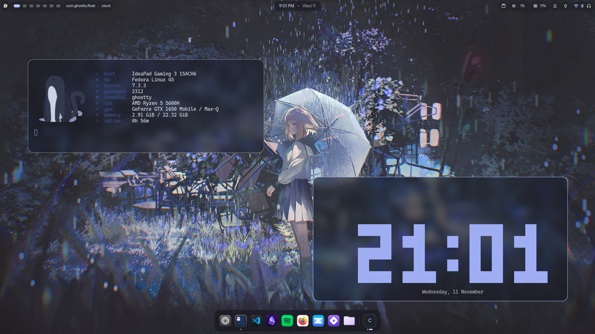
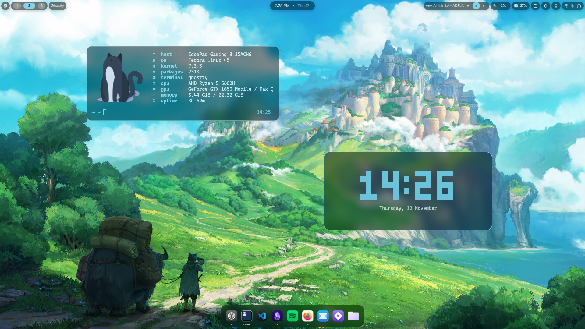
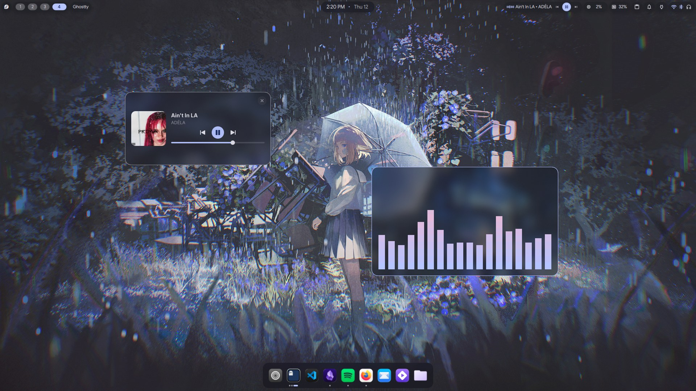

<div align="center">

# niri rice

**Material You niri on Fedora. Pick a wallpaper, everything recolours.**

  







</div>

## What's in it

- [niri](https://github.com/YaLTeR/niri) + [DankMaterialShell](https://github.com/AvengeMedia/DankMaterialShell): bar, dock, launcher, notifications, lock and login screen
- one wallpaper palette across Ghostty, VS Code, Zen, GTK apps, Obsidian, btop, cava and the prompt
- glass with real blur, no titlebars, thin borders
- named workspaces, a drop-down terminal, hourly wallpaper rotation

## Install

```bash
sudo dnf copr enable duxlabs/dms && sudo dnf copr enable duxlabs/dux-repo
sudo dnf install niri dms adw-gtk3-theme ghostty
git clone https://github.com/ahadarshx/niri-rice.git ~/niri-rice
```

Copy each folder to `~/.config/<name>/` (`bin/` to `~/.local/bin/`), then in DMS settings pick the **dynamic** theme and **apply GTK colors**.

## Keys

| | |
|---|---|
| <kbd>Super</kbd>+<kbd>Space</kbd> | launcher |
| <kbd>Super</kbd>+<kbd>T</kbd> · <kbd>`</kbd> | terminal · drop-down |
| <kbd>Super</kbd>+<kbd>1</kbd>…<kbd>4</kbd> | web · code · study · media |
| <kbd>Super</kbd>+<kbd>Y</kbd> | wallpapers |

More in [docs/shortcuts.md](docs/shortcuts.md).

<sub>niri · DankMaterialShell · matugen · adw-gtk3 · Ghostty · Bibata</sub>
