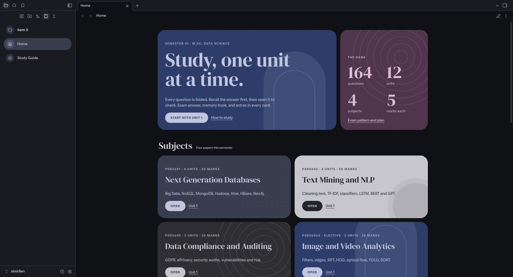

<div align="center">

# niri rice

**A Material You niri desktop on Fedora.**<br>
Pick a wallpaper and the whole system recolours itself: shell, terminal, editor, browser, GTK apps and notes.

    




</div>

## What's in it

- **[niri](https://github.com/YaLTeR/niri)**, a scrolling tiling compositor: windows sit on an endless horizontal strip.
- **[DankMaterialShell](https://github.com/AvengeMedia/DankMaterialShell)** for the bar, dock, launcher, control center, notifications, lock screen and login screen.
- **One palette everywhere.** [matugen](https://github.com/InioX/matugen) turns the wallpaper into a Material You scheme, and DMS writes it into every app on each wallpaper change.
- **Glass.** Panels, the terminal and GTK apps are see-through with real blur of whatever is behind them; text stays sharp.
- **No titlebars**, rounded corners, a thin wallpaper-coloured border.
- **Named workspaces**: web, code, study and media, with apps opening on their own workspace at sensible widths.
- **Drop-down terminal** on <kbd>Super</kbd>+<kbd>`</kbd> that keeps running when hidden.
- **Hourly wallpaper rotation**, so the colours change through the day.

| App | How it follows the wallpaper |
|---|---|
| Ghostty | DMS `dankcolors` theme |
| VS Code | DMS theme extension (`danklinux.dms-theme`) |
| Zen | DMS userChrome colours, no window buttons |
| GTK 3 / 4 apps | adw-gtk3 patched by DMS, plus a glass stylesheet |
| Obsidian | matugen template → CSS snippet (Material You callouts, dashboard cards, sidebar) |
| btop | matugen template → `dms` theme |
| zsh prompt, fastfetch | terminal colour slots, so they follow Ghostty |

## Install

```bash
git clone https://github.com/ahadarshx/niri-rice.git ~/niri-rice && cd ~/niri-rice

# niri, the shell and its theming tools
sudo dnf copr enable duxlabs/dms
sudo dnf copr enable duxlabs/dux-repo
sudo dnf install niri dms adw-gtk3-theme xwayland-satellite ghostty btop fastfetch

# optional: the DMS login screen
sudo dnf install dux-greeter && dms-greeter enable && dms-greeter sync
```

Copy the configs to where they live (back up your own first):

| Folder | Goes to |
|---|---|
| `niri/` | `~/.config/niri/` |
| `ghostty/`, `fastfetch/` | `~/.config/<name>/` |
| `gtk-4.0/gtk.css` | `~/.config/gtk-4.0/gtk.css` |
| `matugen/` | `~/.config/matugen/` (edit the Obsidian output path to your vault) |
| `zen/userChrome.css` | `<Zen profile>/chrome/`, then link `~/.config/dms/zen.css` there as `dms-zen.css` and set `toolkit.legacyUserProfileCustomizations.stylesheets` to `true` |
| `systemd/dms.service.d/` | `~/.config/systemd/user/dms.service.d/` |
| `bin/` | `~/.local/bin/` |
| `zsh/prompt.zsh` | source it from `~/.zshrc` |

Then:

```bash
systemctl --user daemon-reload && systemctl --user restart dms
code --install-extension danklinux.dms-theme          # VS Code colours
flatpak override --user --filesystem=xdg-config/gtk-4.0:ro --filesystem=xdg-config/gtk-3.0:ro
```

In DMS Settings: **Wallpaper & colors → theme: dynamic**, turn on **Background blur** under Interface style, press **Apply GTK colors**, and turn on **wallpaper cycling** (hourly, random) for the rotating colours.

## Keys

The essentials. The full list is in [docs/shortcuts.md](docs/shortcuts.md).

| Keys | Action |
|---|---|
| <kbd>Super</kbd>+<kbd>Space</kbd> | Launcher |
| <kbd>Super</kbd>+<kbd>T</kbd> · <kbd>Super</kbd>+<kbd>`</kbd> | Terminal · drop-down terminal |
| <kbd>Super</kbd>+<kbd>B</kbd> · <kbd>E</kbd> · <kbd>O</kbd> | Zen · Files · Obsidian |
| <kbd>Super</kbd>+<kbd>1</kbd>…<kbd>4</kbd> | web · code · study · media workspaces |
| <kbd>Super</kbd>+<kbd>←</kbd>/<kbd>→</kbd> | Move along the strip |
| <kbd>Super</kbd>+<kbd>R</kbd> · <kbd>F</kbd> | Cycle width · full width |
| <kbd>Super</kbd>+<kbd>Shift</kbd>+<kbd>T</kbd> | Float / tile |
| <kbd>Super</kbd>+<kbd>Y</kbd> | Wallpapers |
| <kbd>Super</kbd>+<kbd>Shift</kbd>+<kbd>S</kbd> | Screenshot a region and annotate it |

## Scripts

| Script | Does |
|---|---|
| `dropterm` | Shows / hides one floating Ghostty, parked on the `scratch` workspace when hidden |
| `shot-annotate` | Region screenshot opened straight in [Gradia](https://github.com/AlexanderVanhee/Gradia) |
| `clock` | Big pixel clock for the terminal, redraws on resize |
| `dms-spotlight-tweak` | Narrower, taller compact launcher (rerun after DMS updates) |
| `fedora-short-boot-titles` | Boot menu entries as `Fedora Linux · 7.3.3` instead of the long default |

`sync.sh` copies the live configs back into this repo.

## Credits

[niri](https://github.com/YaLTeR/niri) by YaLTeR, [DankMaterialShell](https://github.com/AvengeMedia/DankMaterialShell) by Avenge Media, [matugen](https://github.com/InioX/matugen), [adw-gtk3](https://github.com/lassekongo83/adw-gtk3), [Ghostty](https://ghostty.org), Google Sans Flex and DM Serif Display fonts
